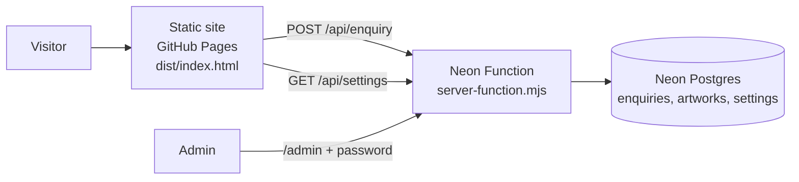

<div align="center">

# WaterOnUs

**The billboard people carry.**
Put your brand on 500 ml water bottles. See it on a real 3D bottle, then send it to the WaterOnUs team.

[**Live site**](https://santosh1664.github.io/aquaad-studio/) &nbsp;·&nbsp;
[Advertise](https://santosh1664.github.io/aquaad-studio/#sides) &nbsp;·&nbsp;
[Distribute](https://santosh1664.github.io/aquaad-studio/#distribute) &nbsp;·&nbsp;
[Partners](https://santosh1664.github.io/aquaad-studio/#partners) &nbsp;·&nbsp;
[Investors](https://santosh1664.github.io/aquaad-studio/#investors) &nbsp;·&nbsp;
[Admin](https://br-long-brook-a1u6whfv-enquiries.compute.c-1.ap-southeast-1.aws.neon.tech/admin)

</div>

---

## Quick links

| | |
|---|---|
| Website | https://santosh1664.github.io/aquaad-studio/ |
| Repository | https://github.com/santosh1664/aquaad-studio |
| Admin inbox (password protected) | https://br-long-brook-a1u6whfv-enquiries.compute.c-1.ap-southeast-1.aws.neon.tech/admin |
| Brand guidelines | [`docs/brand-guidelines.md`](docs/brand-guidelines.md) |
| Original design notes | [`docs/superpowers/specs`](docs/superpowers/specs) · [`plans`](docs/superpowers/plans) |
| Contact | [+91 9191919191](tel:+919191919191) · [hello@aquaad.com](mailto:hello@aquaad.com) |

## What it does

- **Design studio.** A real-time WebGL bottle you can drag to turn (73 mm wide, label area 73 × 170 mm) with seven ad panels for sale: upper and lower on the front, right and left, plus the upper back. Take a single panel or a whole side. The lower back is reserved for WaterOnUs company information.
- **Artwork tools.** Upload JPG, PNG or WEBP (max 3 MB), rotate it, see the exact artwork size and bleed for each panel, and preview a four-sided render of the bottle.
- **Send to WaterOnUs.** The enquiry, the artwork files and the four-sided render go to the admin inbox.
- **Distribute, partner and invest.** Venues, manufacturers, water partners and investors each open a pop-up form.
- **Kept for 24 hours.** Panels, artwork and typed details stay in the visitor's own browser, so a refresh does not lose them.
- **Admin switch.** The admin page can bring back the older gable-top carton model for visitors.

## How it fits together



- **Frontend:** plain HTML/CSS/JS, no build step. Three.js (from jsDelivr) renders the bottle, with a CSS 3D bottle as the fallback. `localStorage` and IndexedDB handle the 24-hour saving.
- **Backend:** one Neon Function (Node 24) with a Postgres database. Public: `POST /api/enquiry`, `GET /api/settings`, `GET /api/health`. Admin (Bearer password): `/api/admin/list`, `artwork`, `update`, `delete`, `settings`.

## Project structure

```
.
├── dist/
│   ├── index.html          the website (deployed to GitHub Pages)
│   ├── bottle3d.js         the WebGL bottle: geometry, materials, render snapshots
│   └── prototype.html      the original Three.js carton prototype
├── server-function.mjs     backend + admin page (Neon Function source)
├── docs/                   brand guidelines and design notes
├── .github/workflows/      GitHub Pages deploy
├── .openai/hosting.json    static hosting config (dist/)
└── index.html              earliest prototype, kept for reference
```

## Run it locally

```bash
cd dist
python3 -m http.server 8765
# open http://localhost:8765/index.html
```

The page talks to the live backend, so test enquiries are real. Delete them from the admin page afterwards.

## Deploy

**Website.** Every push to `main` publishes `dist/` to GitHub Pages through [`pages.yml`](.github/workflows/pages.yml). It takes about a minute.

**Backend.** Deploy the function with the Neon CLI, signed in to the account that owns the project:

```bash
neon function deploy enquiries \
  --project-id cold-king-89170669 \
  --branch br-long-brook-a1u6whfv \
  --src server-function.mjs --no-bundle \
  --env 'ADMIN_PASSWORD=<choose a strong password>'
```

A new deployment replaces the environment, so always pass `ADMIN_PASSWORD` again. Keep the password in `.env.local` (git-ignored) and never commit it.

## Design

Palette, type and voice are written down in [`docs/brand-guidelines.md`](docs/brand-guidelines.md): abyss `#04141C`, aqua `#2BD4F0`, Bricolage Grotesque with Instrument Serif and Geist. 44 px touch targets, visible focus rings, reduced-motion support.

## Status and open items

- **Sizes are provisional.** The 73 × 170 mm label area (two 73 × 85 mm panels per side) is an assumption. Confirm the real label area and base depth with the bottle supplier.
- **Illustrative shape.** The bottle is a concept, not a manufacturer-approved design.
- **No payments or quotes online.** Quotes are handled by the team by phone or email.
- **Not built yet.** Email alerts for new enquiries, automatic deletion of old enquiries, a privacy policy page, and real bottle photography.

## Security and privacy

- Customer enquiries and artwork are stored in Neon Postgres and shown only on the password-protected admin page.
- Uploads are checked by file signature, limited to 3 MB per file, and the form has a spam trap and a consent box.
- The repository is public. Secrets live only in the function's environment and in `.env.local`, which is git-ignored.
- The backend currently accepts requests from any website origin. Restricting it to the live site is a good next step.
